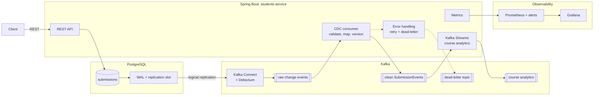
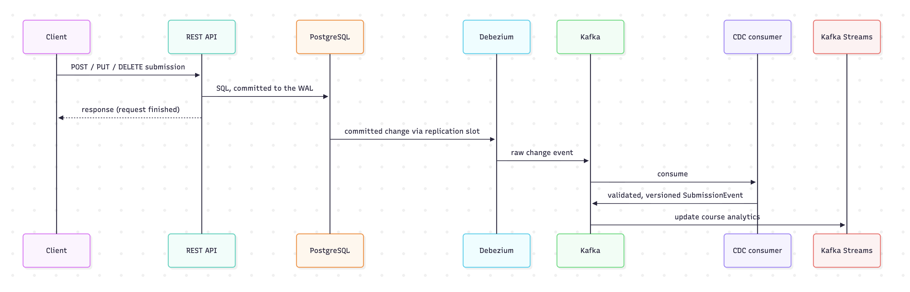
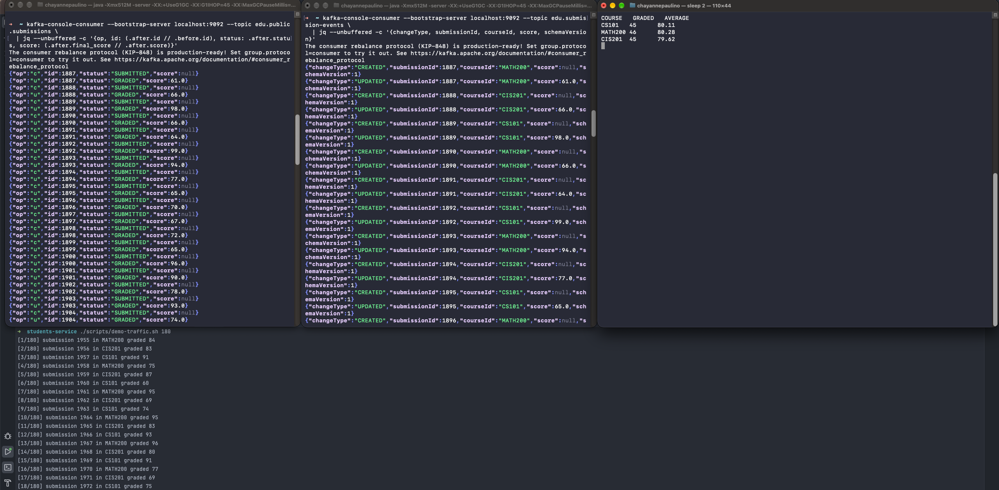
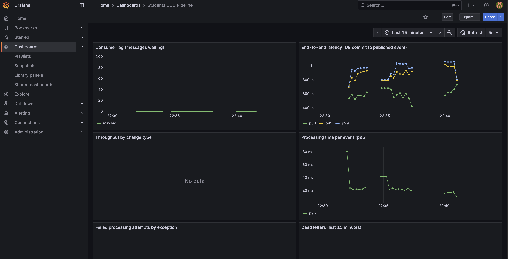
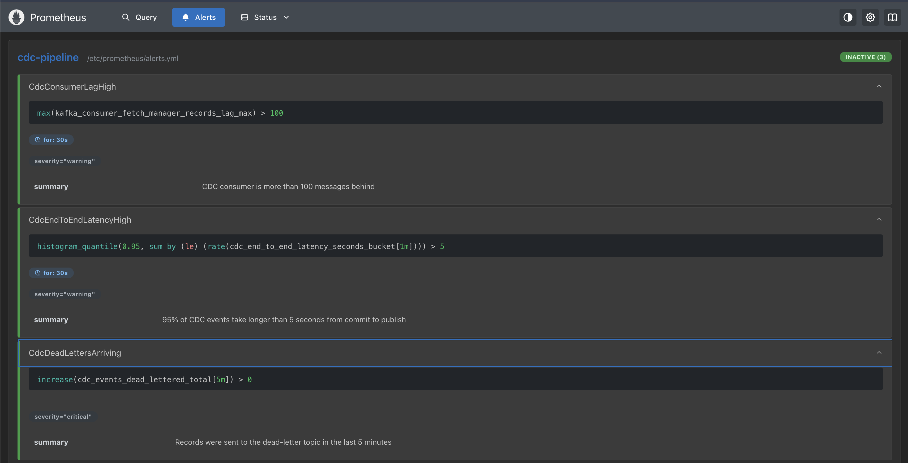
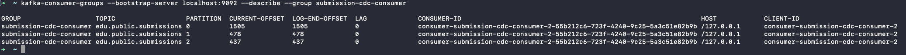
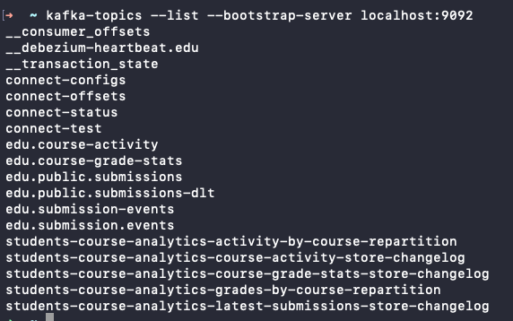

# Students Service: Kafka CDC Pipeline

An event-driven data pipeline for an education platform. Students submit assignments, teachers grade
and return them, and every change to that data is streamed **in real time** to downstream systems
without anyone querying the database.

Changes are captured directly from **PostgreSQL's transaction log** with **Debezium**, streamed through
**Apache Kafka**, validated and turned into clean, versioned business events by a **Spring Boot**
service, and aggregated into live course analytics with **Kafka Streams**. The project also covers
what makes a pipeline production-ready: failure handling, monitoring of processing delays, and safe
schema evolution.


---

## Architecture



The REST side and the event side **never call each other**. They are connected only through the
database and Kafka, so the API stays fast and available even if Kafka or a consumer is down, and
**any** writer to the database produces events, not just this application.

### How one change flows




The same flow, live in the terminal: a graded submission appears as a raw Debezium change event, then
as a clean `SubmissionEvent`, and the course averages computed by Kafka Streams update immediately.



---

## The project, part by part

### 1. REST API and data model
A layered Spring Boot API (controller → service → repository) to create, grade, return, and delete
submissions. Business rules live in the service and model, with row locking to prevent race
conditions, and errors follow the standard Problem Details format. Data access uses plain SQL
(`JdbcClient`) so every statement maps one-to-one to a captured change. The schema is managed with
**Flyway** versioned migrations.

### 2. Change Data Capture with Debezium
**Debezium** runs as a source connector on **Kafka Connect** and reads PostgreSQL's write-ahead log
through a **replication slot** and a **publication** limited to the `submissions` table. Every insert,
update, and delete becomes a change event with the row's before and after state. Because the slot and
Connect's offsets are durable, **no change is lost** while Connect is down; it resumes exactly where it
stopped. This avoids the dual-write problem of publishing events from application code.

### 3. CDC consumer and event contracts
Other teams don't consume the raw Debezium topic, which exposes the table's internal structure. A
Spring Kafka consumer acts as an **anti-corruption layer**: it validates each row against a
**JSON Schema** contract for the table, maps it to a clean, versioned `SubmissionEvent`, validates that
against the published event contract, and publishes it keyed by submission id to preserve per-entity
ordering. The input offset is committed only after Kafka confirms the output (**at-least-once**), and
each event carries a **deterministic id** derived from the WAL position so duplicates are detectable.

### 4. Processing failures
Failures are **classified by type**. Permanent failures (invalid JSON, schema violations) are poison
pills and go straight to a **dead-letter topic** with headers recording their origin and cause.
Temporary failures get **blocking retries with exponential backoff**, chosen over retry topics to keep
events in order per submission. Dead letters are logged for alerting and can be **replayed** through
an admin endpoint once the cause is fixed, with a replay counter to prevent loops.

### 5. Processing delays and observability
The service measures **consumer lag** (messages waiting) and **end-to-end latency** (database commit to
published event) as Prometheus metrics with percentile histograms. Both are needed: when Debezium falls
behind, lag stays at zero while data ages. **Prometheus** alert rules fire on high lag, high p95
latency, and dead-letter arrivals, and **Grafana** charts throughput and failures. Load experiments
covered slow consumers, scaling with partitions and consumer concurrency, rebalances caused by
exceeding `max.poll.interval.ms`, and upstream delays.

During a burst of 300 changes against a deliberately slowed consumer, lag and end-to-end latency rise,
the backlog drains, and the failure panels record two dead letters:



The alert rules fire while the pipeline is behind and when records reach the dead-letter topic:



Consumer lag per partition at the peak of the burst:



### 6. Real-time analytics with Kafka Streams
A **Kafka Streams** topology computes live course analytics from the clean events:
- **Course activity:** new submissions per course in one-minute **event-time windows** with a grace
  period for late events.
- **Course grade statistics:** a **KTable** of the latest version of each submission, aggregated per
  course with an adder and a subtractor, so averages stay correct through re-grades and deletions.

State lives in RocksDB stores backed by **changelog topics** (restored automatically after data loss),
processing is **exactly-once**, and the stores are queryable over REST (**interactive queries**).

### 7. Schema evolution
The **database schema** and the **event schema** are treated as separate contracts:
- An unannounced column addition is caught by the strict row contract and routed to the dead-letter
  topic instead of producing malformed events, then fixed forward with **v2 contracts** and a replay.
- A **compatibility test in CI** checks every new event schema version for backward and forward
  compatibility, a lightweight version of a Schema Registry check.
- A breaking column rename was done with **expand → migrate → contract**, and the published event
  never changed: the anti-corruption layer absorbed it, so downstream consumers were unaffected.
- Consumers are **tolerant readers**, and breaking event changes follow a new-version, dual-publish,
  deprecation-window strategy.

### 8. Quality gates
Every pull request runs through **GitHub Actions**: build and tests (unit tests, a topology test with
`TopologyTestDriver`, and integration tests against a real PostgreSQL and an embedded Kafka broker),
**SpotBugs** static analysis, and **CodeQL** security scanning, with **Dependabot** keeping dependencies
current. The `main` branch is protected: nothing merges unless every check passes.

---

## Kafka topics

| Topic | Produced by | Contents |
|---|---|---|
| `edu.public.submissions` | Debezium | Raw change events from the `submissions` table |
| `edu.submission-events` | CDC consumer | Clean, versioned `SubmissionEvent` messages |
| `edu.public.submissions-dlt` | Error handler | Messages that failed processing, with failure details |
| `edu.course-activity` | Kafka Streams | New submissions per course per minute |
| `edu.course-grade-stats` | Kafka Streams | Current grade statistics per course (compacted) |

Besides these, the broker holds Kafka Connect's internal topics (configs, offsets, status) and the
repartition and changelog topics Kafka Streams creates for its state stores:



## Tech stack

| Area | Technology |
|---|---|
| Language and framework | Java 21, Spring Boot 4, Spring for Apache Kafka |
| Database | PostgreSQL 17, Flyway |
| Messaging | Apache Kafka 4 (KRaft) |
| Change Data Capture | Debezium PostgreSQL connector on Kafka Connect |
| Stream processing | Kafka Streams |
| Event contracts | JSON Schema (draft 2020-12) |
| Observability | Micrometer, Prometheus, Grafana |
| CI | GitHub Actions, SpotBugs, CodeQL, Dependabot |

## Key design decisions

- **CDC over dual writes:** the database commit is the single source of truth for events.
- **Anti-corruption layer:** consumers depend on a stable event contract, not on the table layout.
- **At-least-once with idempotency:** input offsets commit only after output is confirmed; deterministic
  event ids make duplicates detectable.
- **Classified failures:** poison pills are set aside immediately; temporary failures are retried in
  order.
- **Two delay signals:** consumer lag for the consumer, end-to-end latency for the whole pipeline.
- **Versioned, compatibility-checked contracts:** published schema versions are never edited, only added.

## Running locally

Requires Java 21, Docker, and Kafka installed locally (for example with Homebrew).

1. Start PostgreSQL, Prometheus, and Grafana: `docker compose up -d`
2. Start Kafka, then Kafka Connect with the Debezium plugin, and register the connector in `connect/`
3. Start the application: `./mvnw spring-boot:run`


| Service | URL |
|---|---|
| REST API | http://localhost:8080/api/v1/submissions |
| Course analytics | http://localhost:8080/analytics/courses/grade-stats |
| Metrics | http://localhost:8080/actuator/prometheus |
| Prometheus | http://localhost:9090 |
| Grafana | http://localhost:3000 |

## Project structure

```
students-service/
├── src/main/java/.../students_service/
│   ├── controller/      REST endpoints
│   ├── service/         business logic, CDC processing, replay, analytics queries
│   ├── repository/      SQL data access
│   ├── model/ dto/      domain model and API contracts
│   ├── event/           Debezium envelope, SubmissionEvent, mapping
│   ├── kafka/           CDC listener, event publisher, dead-letter inspector
│   ├── streams/         Kafka Streams topology and analytics models
│   ├── schema/          JSON Schema validation
│   ├── metrics/         pipeline metrics
│   └── config/          topics, error handling, typed properties
├── src/main/resources/
│   ├── db/migration/    Flyway migrations
│   └── schemas/         row and event JSON Schema contracts
├── connect/             Kafka Connect worker and Debezium connector configuration
├── observability/       Prometheus scrape config, alert rules, Grafana provisioning
└── .github/             CI workflows and Dependabot
```
